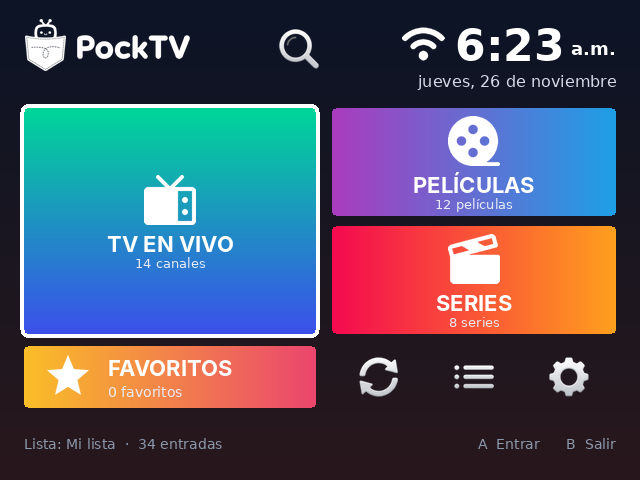
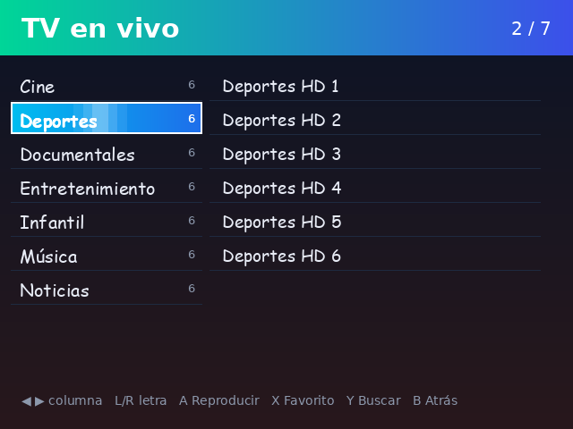
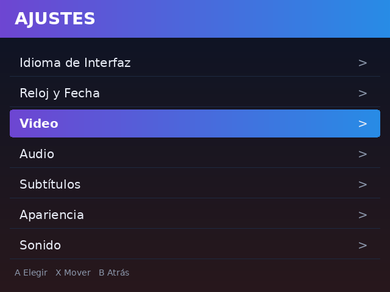
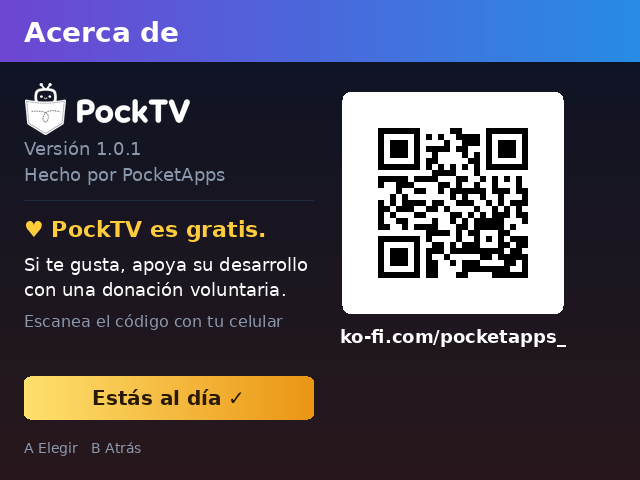

# PockTV

**Español** · [English](#english)

Reproductor de video con interfaz propia para **Miyoo Flip V2** con **SpruceOS** (pantalla 640×480). Reproduce tu propia lista M3U con TV en vivo, películas y series, desde el control de la consola.

 
 

*Capturas generadas con la interfaz de la app.*

## Descargar

1. Entra a la [última versión (Releases)](https://github.com/PocketApps-PR/PockTV/releases/latest).
2. En **Assets** descarga **`PockTV.zip`**. (No descargues *Source code*: es solo una copia de este repositorio.)

## Qué incluye

- TV en vivo, Películas, Series y Favoritos, con listas por categoría y búsqueda por nombre.
- Búsqueda maestra: busca en TV, películas y series a la vez.
- Reproductor interno, con cambio rápido de canal, pausa, audio y subtítulos a elegir.
- Funciona con enlaces `http` y `https`.
- Interfaz en varios idiomas, y reloj, logo y apariencia personalizables.
- **Actualizaciones dentro de la app**: en *Ajustes → Acerca de*; un punto rojo avisa cuando hay versión nueva.

## Importante

**PockTV no incluye canales, listas ni contenido de ningún tipo.** Cada persona usa su propia lista M3U, de una fuente que tenga derecho a usar (canales gratuitos oficiales, TV pública o un servicio de streaming que tengas contratado).

## Instalación

1. Extrae `PockTV.zip`: queda la carpeta `PockTV`. Cópiala a `/mnt/SDCARD/App/` en la tarjeta SD.
2. Pon tu lista dentro de la carpeta `PockTV`:
   - un archivo `lista.m3u`, o
   - un archivo `lista.url` con **una sola línea**: la dirección de tu lista.
3. En la consola abre **Apps → PockTV**.

Más listas: ponlas en `PockTV/listas/` (`.m3u`, `.m3u8` o `.url`) y cámbialas con el icono *Cambiar de Lista*.

Probada en **Miyoo Flip V2** con SpruceOS. No se ha probado en otras consolas.

## Controles

| Botón | Acción |
|---|---|
| D-pad | Moverse |
| A | Entrar / reproducir |
| B | Atrás / salir |
| X | Marcar o quitar favorito |
| Y | Buscar |
| L1 / R1 | Saltar de letra en las listas |
| Menú de la consola | Volver al inicio |

## Actualizar

Entra a **Ajustes → Acerca de → Buscar actualizaciones**. Si hay una versión nueva, la app te pregunta antes de instalarla y conserva tus listas y ajustes.

## Cómo está hecha

Está escrita en **Python**, con **PySDL2** para la interfaz (el mismo Python y PySDL2 que trae SpruceOS) y **ffmpeg** para el video. No hay nada que compilar. El código está en la carpeta [`PockTV/`](PockTV), con la misma estructura que el zip.

## Letras y licencias

- La interfaz usa **Comic Neue** (SIL Open Font License; ver `PockTV/fonts/OFL-ComicNeue.txt`) y también DejaVu Sans, Inter, Lora y Poppins, todas de licencia libre.
- Cada fuente conserva su propia licencia.

## Apoyar el proyecto

PockTV es gratis. Si te gusta, puedes apoyar su desarrollo con una donación voluntaria:

---

# PockTV (English)

Media player with its own interface for the **Miyoo Flip V2** running **SpruceOS** (640×480 screen). Play your own M3U playlist: live TV, movies and series, all from the console's controls.

## Download

1. Go to the [latest release](https://github.com/PocketApps-PR/PockTV/releases/latest).
2. Under **Assets**, download **`PockTV.zip`**. (Do not download *Source code*: it is only a copy of this repository.)

## Features

- Live TV, Movies, Series and Favorites, with category lists and search by name.
- Master search across TV, movies and series at once.
- Built-in player with fast channel switching, pause, audio and subtitle selection.
- Works with `http` and `https` links.
- Interface in several languages; clock, logo and look are customizable.
- **In-app updates**: *Settings → About*, with a red dot when a new version is available.

## Important

**PockTV does not include any channels, playlists or content.** Everyone uses their own M3U playlist, from a source they are entitled to use (official free channels, public TV, or a streaming service you subscribe to).

## Install

1. Extract `PockTV.zip`: you get a `PockTV` folder. Copy it to `/mnt/SDCARD/App/` on the SD card.
2. Put your playlist inside the `PockTV` folder:
   - a `lista.m3u` file, or
   - a `lista.url` file with **one single line**: the address of your playlist.
3. On the console open **Apps → PockTV**.

More playlists: put them in `PockTV/listas/` (`.m3u`, `.m3u8` or `.url`) and switch with the *Change List* icon.

Tested on the **Miyoo Flip V2** with SpruceOS. Not tested on other devices.

## Update

Go to **Settings → About → Check for updates**. If there is a new version, the app asks before installing and keeps your lists and settings.

## How it's made

Written in **Python**, using **PySDL2** for the UI (the same Python and PySDL2 that ship with SpruceOS) and **ffmpeg** for video. Nothing to compile. The code is in the [`PockTV/`](PockTV) folder, with the same structure as the zip.

## Fonts and licenses

- The interface uses **Comic Neue** (SIL Open Font License; see `PockTV/fonts/OFL-ComicNeue.txt`), plus DejaVu Sans, Inter, Lora and Poppins, all freely licensed.
- Each font keeps its own license.

## Support

PockTV is free. If you like it, you can support its development with a voluntary donation:

